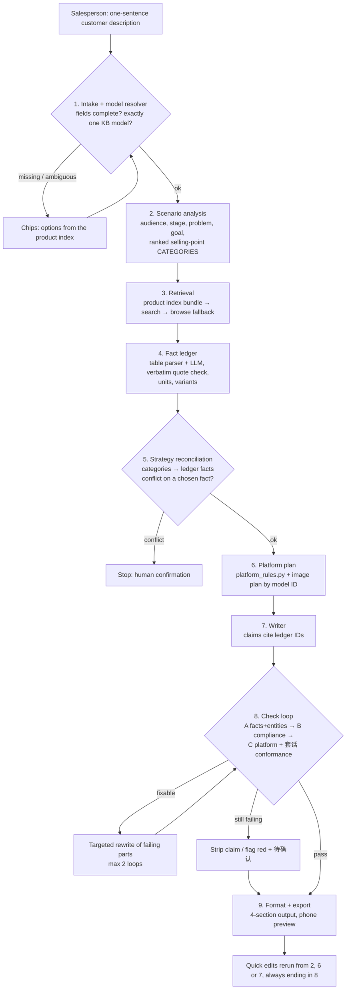

# Huawei PC Marketing Agent — Workflow (v4)

**Pitch:** a sales assistant for Huawei store staff. Describe a customer in one sentence and get a verified, ready-to-post article for the right platform, usually in about a minute. (Measure this and quote the real number in the demo.)

**Core idea:** every product claim in an article must trace back to a **fact ledger** entry, and every ledger entry must trace back to a **verbatim quote** in an ima document. Code, not the LLM, enforces both links. If a fact isn't in the ledger it can't be in the post, and if a quote isn't in the source it can't be in the ledger.

> **Changes from v3** (every change traced to a handbook line, see §9):
> - ima is called through the handbook's standard script `ima-skill/ima_api.cjs` ("统一调用脚本"), not a self-written client.
> - API Key **and Client ID** never appear anywhere; screenshots and the video show "已配置", no key characters.
> - `examples/` and the repo never contain KB text or KB image files ("不得…对外传播资料").
> - 8A also blocks unbacked policy and benefit promises (企业采购, 新品首发 scenarios).
> - No "最" allow rule: every 最 phrase is rephrased ("禁止绝对化宣传").
> - The app finds the shared KB by name at startup and shows its status ("找到指定共享知识库").
> - The ModelScope page must match the repo and the 说明书.
> - Unverified claims removed: error codes, signed-URL behaviour, legal-guidance reference, latency numbers, licence claim.
>
> **Changes from v2** (kept from v3):
> - Section 四 heading fixed to the handbook's **核验结果** (v2 had 校验结果).
> - 图片来源 added to section 二, as the handbook's flow line requires.
> - 8A now blocks invented **sales, stock, awards, user reviews and benchmark results**, not just prices.
> - `agent/platform_rules.py` replaces `platforms.yaml`, so the handbook's "避免套话" requirement is enforced in 8C, along with emoji, tag and poster limits.
> - Platform tags (平台标签) are always output; hashtags only appear in the visible post where the platform allows them.
> - Platform build order: 公众号 → 小红书 → 朋友圈 (live-tested) → 海报 → 抖音.
>
> **Changes from v1** (kept from v2):
> - The model resolver is merged into intake.
> - Strategy is split: a category-level scenario analysis runs first, and a reconciliation step after the ledger exists.
> - Ledger rows need a verbatim quote that code checks against the source.
> - The conflict gate is variant-aware and only stops on facts the article uses.
> - Images are matched by model ID, never by name substring.
> - A final **platform conformance check** is added.
> - Every rewrite re-runs the code checks.
> - The public demo gets protections.
> - The build order delivers an end-to-end skeleton first.

---

## 1. Rules we never break

From the competition handbook. Breaking one can zero a score item or disqualify us.

1. Models, specs, features, prices and selling points come **only** from 任德耀新建华为PC知识库.
2. Images come **only** from ima, matched to the exact model, each with source, caption and insertion position.
3. Never invent prices, discounts, subsidies, stock, sales figures, awards or user reviews. If one is requested but not in the KB, refuse and mark it `待确认`.
4. Source conflict → stop and ask a human ("资料冲突时停止输出并提示人工确认"). Our reading: stop when the conflict touches a fact the article would use; a conflict on an attribute the article doesn't use is excluded and listed under 待确认. State this reading in the 说明书.
5. Missing info → ask, don't guess.
6. Changing the platform must change title, structure, tone, image count and CTA. Changing the scenario must change the angle and the selling-point order.
7. No absolute claims, false promises, unsupported comparisons, misleading prices or competitor bashing.
8. ima supplies data only. Our agent writes the article.
9. Every run outputs the unified 4-section format. Use the handbook's Chinese headings **verbatim**: 一、场景判断 / 二、知识库依据 / 三、图文软文 / 四、核验结果.
10. **API Key and Client ID** only in environment variables or ModelScope secrets. Never in code, README, docs, GitHub or submitted files ("不得包含API Key、Client ID或其他密钥"), never in screenshots or the demo video ("不得出现在…截图、演示视频"), never pasted into chat tools.
11. KB is read-only: never delete, modify or spread its material ("不得删除、修改或对外传播资料"). Never commit KB text or KB image files, including in `examples/`. The public app never offers bulk export of KB text or images.
12. No hardcoded outputs, faked runs or hidden manual writing.
13. All submission links open without login during judging.
14. **Any text shown to a customer or salesperson that mentions the product goes through the checks**, including the talk card and every edit.

---

## 2. Pipeline overview



Gates (diamonds) can stop the run, ask the user, or flag output. Every stage passes **typed JSON** to the next, and each stage's input and output is logged.

---

## 3. Stage by stage

### 1. Intake + model resolver (gate)
- **Input:** free text, e.g. "A mom wants a laptop for her daughter starting university next month, for Xiaohongshu."
- **Does:** extracts `product`, `audience`, `scenario`, `platform` (LLM). Then **code** resolves `product` against the product index (fuzzy match on canonical names and aliases).
- **Gate (code):**
  - a missing field → 2–4 chips, e.g. platform `[小红书] [朋友圈] [公众号] [海报]`;
  - several close model matches → chips with those exact KB model names;
  - no match → "not in the knowledge base", plus chips with the nearest KB models;
  - **product unknown but needs given** ("想要轻薄本") → chips with KB models whose ledger facts fit the need (e.g. lightest by KB weight). These are choices, not claims, so they are not comparisons in an article.
- One question round covers everything that's missing. Never ask twice when once will do.

```json
{"product": null, "product_candidates": ["<KB model A>", "<KB model B>"],
 "audience": "university freshman (buyer: parent)", "scenario": "back-to-school",
 "platform": "xiaohongshu", "missing": ["product"]}
```

### 2. Scenario analysis
- **Does:** audience, buying stage, main problem, content goal, and ranked selling-point **categories** (e.g. portability → battery → multi-device), using `config/scenarios.yaml` (the 8 handbook scenarios with focus points and forbidden moves).
- **Why categories only:** this stage hasn't seen the KB, so it must not name specs.
- **Built with:** strong LLM.

### 3. Retrieval
- **Does:**
  1. Product index bundle: the model's `article.md` and its images, located by **folder or model ID**.
  2. `search_knowledge` with model + task keywords for extra material, keeping only results inside the model's folder or clearly general folders.
  3. Empty search → browse with `get_knowledge_list` into `P1-产品参数库` (handbook requirement).
  4. `get_media_info` for the original text or access link ("获取命中资料原文或访问链接"). Don't store access links long-term; fetch them when displaying. Check in Phase 1 how long a link stays valid.
- **Logs:** every API call, source title and path (never IDs in the UI, never keys).
- **Built with:** `agent/ima_wrapper.py`, which calls the handbook's standard script `node ima-skill/ima_api.cjs <endpoint> '<json>'` through `subprocess` and parses its output. Only the four handbook endpoints: `search_knowledge_base`, `get_knowledge_list`, `search_knowledge`, `get_media_info`.
- **Why the script:** the handbook says "统一调用脚本为 ima-skill/ima_api.cjs" and "解压后保留完整目录". Using it is the strictest reading.
- **Error handling:** if a call fails, retry once, then show a plain-language message. Read `ima_api.cjs` in Phase 0 to learn its real error output; this doc doesn't assume any error codes.
- **Short cache** of results per model, so repeat runs and edits don't re-call ima.

### 4. Fact ledger ⭐
- **Extraction:** spec **tables** in `article.md` are parsed by **code**. Prose (features, descriptions) is extracted by the fast LLM. Every row must carry a `quote`.
- **Grounding check (code):**
  - `quote` must appear verbatim in the source (after whitespace and width normalization), **and**
  - `value` must appear inside `quote`.
  - Rows that fail are dropped and logged. This stops the ledger itself from being hallucinated.

| ID | model | variant | attribute | value | unit | quote | source path |
|---|---|---|---|---|---|---|---|
| F1 | Model-A | all | weight | `<from KB>` | g | `<verbatim>` | P1-产品参数库/Model-A/article.md |
| F2 | Model-A | 32GB版 | memory | `<from KB>` | GB | `<verbatim>` | … |
| F3 | Model-A | all | feature | multi-device collaboration | — | `<verbatim>` | … |

- **Unit normalization** (`config/units.yaml`), canonical unit for storing and comparing:

| Seen in text | Canonical |
|---|---|
| 1.38kg, 1380g, 1.38公斤, 1380克, 约1.38kg | g (keep the `约` qualifier) |
| 14英寸, 14寸, 14-inch, 14" | inch |
| 70Wh, 70瓦时 | Wh |
| 120Hz, 120赫兹 | Hz |
| 1TB vs GB | compare tiers (1TB ≡ 1000GB ≡ 1024GB); never mix with RAM |
| ranges / "最高X" / "最长X小时" | store as an upper bound plus the original wording |

- **Variants:** values that differ by configuration (RAM, storage, CPU, colour, weight per configuration) are a **variant set**, not a conflict. Write them as "16GB/32GB 可选" or pick the variant the user asked for.
- **Conflict =** same model + same attribute + same variant scope + different values after normalization.

### 5. Strategy reconciliation (gate)
- **Does:** maps each selling-point category from step 2 onto ledger facts. Categories with no facts are dropped and recorded in the strategy card ("no KB battery data → battery not used"). The output is the final ordered selling points **as ledger IDs**, with a one-line reason for each, plus a 3-line "what to say" talk card for the salesperson.
- **Gate:** a conflict touching a **chosen** fact → stop and ask a human. A conflict on an unused attribute → exclude that attribute and list it under `待确认`, then continue.
- **Built with:** strong LLM + code (IDs must exist).

### 6. Platform plan
- **Rules:** `agent/platform_rules.py`, loaded deterministically. It holds `PLATFORM_RULES` (per platform) and `WRITING_RULES` (human-sounding writing, all platforms).
- **Used twice:** `build_prompt_rules(platform)` goes into the writer prompt (step 7); `check_post(...)` runs inside 8C.

| Platform | Images | Body (chars) | Emoji | Hashtags | Structure | CTA | Build order |
|---|---|---|---|---|---|---|---|
| `wechat_article` 公众号 | 2–4 | 800–1500 | 0 | 0 | 标题 + 导语 + 分段正文 + 结尾引导 | 到店 / 关注 / 留言 | 1 (live-tested) |
| `xiaohongshu` 小红书 | 3–6 | 300–600 | ≤6 | 3–8 | 口语化标题 + 短段落 + 场景 + 话题标签 | 收藏 / 评论 / 到店 | 2 (live-tested) |
| `moments` 门店朋友圈 | 1–3 | 50–150 | ≤2 | 0 | **一个核心卖点** + 到店或咨询引导 | 到店 / 私信 | 3 (live-tested) |
| `poster` 门店海报 | 1 | 20–80 | 0 | 0 | 主标题 (≤10字) + 副标题 + ≤3 卖点 + 活动说明 (KB only) | 到店 | 4 |
| `douyin` 抖音图文 | 3–9 | 100–300 | ≤4 | 2–5 | 钩子首句 + 2–3 短段 + 话题; 每图说明 ≤12字 | 评论 / 私信 / 到店 | 5 (our extension) |

- **From the handbook:** image ranges, the structure of the four official platforms, Moments' single selling point, the poster's ≤3 points and no stretching, no faked personal experience on 小红书. **Our choices:** body lengths, emoji and hashtag counts, the poster's 10-character title, everything about 抖音. Never present our numbers to judges as handbook rules.
- **Live test:** judges pick randomly from 公众号, 小红书 and 朋友圈, so those three must be solid before 海报 or 抖音 get any time.
- **平台标签:** the handbook's generation requirement lists "平台标签" for every output. Always fill the `tags` field and show it in section 三. Put hashtags in the visible post only where the platform allows them (小红书, 抖音).
- **Fixes `platform_rules.py` needs before use:**
  1. `WRITING_RULES` example `写“重量约1.3kg”` → `写“重量约X kg [F1]”`. A real-looking number in the prompt can be copied into a post for a model with a different weight.
  2. `check_post` must take the writer's **JSON post**, not one string, so it can check the CTA, Moments' selling-point count, the poster title and Douyin captions.
  3. Add the body-length **lower** bound.
  4. Keep advertising-law absolutes (最, 第一, 唯一…) out of `AI_TELL_PHRASES`; they live in `config/banned_words.txt` for 8B.

- **Image plan (code):**
  - Candidates are images whose **model ID** in the product index equals the target. Never use a name substring: "MateBook 14" must not match "MateBook 14s".
  - Each image gets a role (main / scene / detail) from its file name, folder or the surrounding article text, or `unknown`.
  - Count comes from the platform range. If the KB has fewer images than the minimum, **do not pad** with sibling or generic images. Use what exists and add `待确认: 知识库该型号图片不足`.
  - Captions come only from the image title or the article text next to it. Never describe content we can't see.

### 7. Writer
- **Prompt =** `prompts/system_prompt.md` + reconciled strategy (step 5) + `build_prompt_rules(platform)` + the target model's ledger rows + the image plan.
- **Output is JSON,** so code can check each field. Every field is filled on every platform (the handbook's generation requirement); fields a platform doesn't show, like a Moments title, appear only in the 4-section output.

```json
{"title": "", "intro": "", "body": [""], "cta": "", "tags": [""],
 "selling_points": ["F1", "F3"],
 "images": [{"image_id": "", "position": "", "caption": ""}]}
```
- **Hard rules in the prompt:**
  - every product claim cites a ledger ID: `weighs only … [F1]`;
  - no spec-like claim without an ID ("lasts all day" counts as a battery claim);
  - life-scenario language is allowed only as a description of a cited fact;
  - no prices, promotions or comparisons unless they exist in the ledger;
  - images only from the plan, by ID, with their positions;
  - the `WRITING_RULES` list (no 赋能/打造, no 不仅仅是……更是, no 综上所述, no ——, varied sentence length).

### 8. Check loop (gate) ⭐
Runs in this order. **Any rewrite sends the text back through the whole loop**, so a rewrite can't sneak in an unverified fact. Maximum 2 loops.

**8A. Fact and entity check (code first)**
1. Every number next to a unit or spec word (g, kg, 英寸, Wh, Hz, GB, 小时, 核, W, nits …) → normalize → must match a ledger value **for the target model and the variant in use**.
2. **Entity check:** chip names, ports, display tech and named features (e.g. OLED, 雷电4, 超级终端) are matched against the ledger's entity list. A term that exists in a **sibling model's** ledger but not the target's → "疑似混入相近型号参数" → strip.
3. Every cited ID exists and belongs to the target model.
4. Whitelist by **pattern**, not by "any small number": years (2026), `N 个理由/场景/步`, dates, store hours, hashtags. `3 个USB口` is a spec, not a list count.
5. **Invented-claim patterns** without a ledger entry → always fail. The handbook zeroes accuracy and compliance for any of these:
   - price: 元, ¥, 优惠, 补贴, 折, 立减, 赠, 到手价
   - sales: 销量, 卖出, 热销, 爆款
   - stock: 库存, 现货, 仅剩, 限量
   - awards: 奖, 荣获, 认证, 榜
   - reviews: 好评, 用户反馈, 口碑, 评分
   - benchmarks (content-creation scenario, "不得虚构软件测试结果"): 跑分, 实测, 测试结果, 渲染时间
   - policies and benefits (企业采购 "未在知识库出现的政策不得承诺"; 新品首发 "价格与权益必须有资料依据"): 保修, 质保, 上门, 以旧换新, 分期, 免息, 权益, 赠品
6. LLM layer (fast model): non-numeric claims must be supported by the cited fact, and fuzzy claims without IDs are flagged.

**8B. Compliance**
- Code: `config/banned_words.txt` (最, 第一, 顶级, 唯一, 100%, 国家级, 绝对, 史上, 全网, 首选, 万能, 永久 …) and a competitor brand list.
- **No allow rule for 最.** The handbook says "禁止绝对化宣传" with no exceptions, so every 最 phrase is rephrased, even when the KB uses it: "最高120Hz" → "支持120Hz刷新率". The ledger fact and its source don't change, only the wording.
- LLM: false promises, misleading prices, unsupported comparisons, competitor bashing, fake personal experience on Xiaohongshu.

**8C. Platform and writing conformance (code, `check_post`)**

| Check | Source |
|---|---|
| Image count in range | Handbook |
| Required blocks present and in order; CTA present | Handbook |
| Moments: exactly one selling-point attribute | Handbook ("一个核心卖点") |
| Poster: ≤3 selling points, 1 image | Handbook |
| Poster title ≤10 chars; Douyin captions ≤12 chars | Ours |
| Body length within range (both bounds) | Ours |
| Hashtags only where allowed, count in range; emoji limit | Ours |
| No `AI_TELL_PHRASES` / `AI_TELL_PATTERNS`; no ——; ≤2 exclamation marks | Handbook ("避免套话") + our word list |

Stripping in 8A/8B can break structure or length, which is why 8C runs last.

**On failure after 2 loops:** keep the claim highlighted red with the reason (UI) and list it under `待确认`. Then strip all `[F#]` tags from the publishable post, keeping the mapping for click-to-source.

### 9. Format + export
Produces the unified output. Copy the exact Chinese headings from the handbook:

```
一、场景判断    目标人群 / 使用场景 / 用户问题 / 内容目标 / 平台
二、知识库依据  产品型号 / 事实点 (ledger IDs) / 资料标题 / 图片来源
三、图文软文    标题 / 导语 / 正文 / 行动引导 / 图片名称·来源·插入位置·说明
四、核验结果    产品事实 / 图片型号 / 合规 / 待确认信息
```

Plus the phone-mockup preview, one-tap copy and a .docx/.md download of **our** article. Images are shown inline and saved one at a time, with no bulk image zip on the public app (rule 11).

### Quick edits
| Edit | Reruns from | Then |
|---|---|---|
| Shorter / longer, change tone | 7 Writer | 8 → 9 |
| Change selling point, another angle | 5 Reconciliation (ledger reused) | 6 → 7 → 8 → 9 |
| Switch platform | 6 Platform plan (ledger and strategy reused) | 7 → 8 → 9 |
| Different audience or scenario | 2 Scenario analysis (ledger reused) | 5 → … → 9 |
| All platforms at once | 6 in parallel for each platform | 7 → 8 → 9 each |

The ledger is cached **per model** (keyed by source document and refresh time), so edits and repeat runs don't re-extract it.

---

## 4. What the salesperson sees

1. One link on their phone. No install, no login.
2. One text box. Tap **Generate**.
3. Missing info → chips to tap, with model chips taken from the KB.
4. Live progress: `Reading spec sheet… Matched 4 images… Checking 12 facts ✓… Compliance ✓`.
5. Post shown inside a phone mockup of the platform. A "what to say" card on top (also checked).
6. Green banner if everything is verified. Problems highlighted red with the reason.
7. **Tap any sentence → see its ledger fact, the verbatim quote and the source document title.**
8. Buttons: Shorter · Switch platform · Change selling point · Another angle · All platforms · Copy · Download.
9. "Details" opens the required 4-section output.
10. Status bar: account, KB name (found by `search_knowledge_base` at startup), connection status, and "密钥已配置 ✓". No key or Client ID characters, so screenshots and the video stay clean.

---

## 5. Under the hood

- **KB check at startup:** call `search_knowledge_base` with "任德耀新建华为PC知识库", read `data.info_list[0].kb_id`, and show the KB name and connection status ("识别当前账号；找到指定共享知识库"). The kb_id is used inside the program only ("知识库ID仅在程序内部使用").
- **Product index at startup:** walk the KB directory once, map model ID → canonical name, aliases, sibling group, spec doc, images. Keep it in memory and refresh it on a timer and with a button, because the latest KB content counts. Never committed.
- **Two LLMs:** a strong one for scenario analysis, reconciliation and writing; a fast one for extraction and checks.
- **Speed:** measure each stage on the deployed app and quote the real number in the pitch. Pre-warm the ledgers of the most-used models at startup.
- **Parallelism:** platform versions generate at the same time. The LLM parts of 8A and 8B run at the same time. 8C runs after both.
- **Public demo protections:** per-session rate limit, a max runs per hour, no raw KB article viewer (only quoted snippets that back a claim), no bulk export, and errors shown in plain language. The link has to be open to judges, which also makes it open to everyone using our ima quota.
- **Run logs:** inputs, sources, ledger, images and check results per run (never keys, Client ID or access links). Used for traceability and the 说明书. Curated examples go to `examples/` with **our article, source document titles and image names only**: no ledger quotes, no KB text, no image files.
- **Fallbacks:** empty search → browse with `get_knowledge_list` (handbook requirement). ima call fails → retry once, then a plain-language message. LLM error → one retry, then a plain-language message. Missing images → flag, never pad.

| Layer | Choice |
|---|---|
| Language | Python 3.10+ |
| UI | Gradio + custom HTML/CSS |
| Deployment | ModelScope Studio. Needs Python **and Node.js**; confirm in Phase 0 that Node runs there. If it doesn't, raise it with the team before writing any workaround. |
| LLM | Qwen (DashScope) or DeepSeek, OpenAI-compatible client |
| ima | `agent/ima_wrapper.py` → `node ima-skill/ima_api.cjs` via `subprocess` (handbook's standard script) |
| Secrets | `.env` locally, ModelScope secrets online |

---

## 6. Repo layout

```
app.py                  # Gradio UI
agent/
  ima_wrapper.py        # subprocess wrapper around ima-skill/ima_api.cjs (read-only endpoints)
  catalog.py            # product index, resolver, sibling groups
  intake.py
  scenario.py           # step 2
  retrieval.py          # step 3
  ledger.py             # parser + LLM extraction, quote check, units, variants, conflicts
  reconcile.py          # step 5 + talk card
  platform_rules.py     # PLATFORM_RULES, WRITING_RULES, build_prompt_rules, check_post
  platform_plan.py      # step 6 incl. image plan
  writer.py
  checks/
    facts.py            # 8A numbers + entities + sibling check
    compliance.py       # 8B
    conformance.py      # 8C, calls platform_rules.check_post
  formatter.py
prompts/                # system prompt (8 handbook modules) + one per LLM stage (judges read these)
config/
  scenarios.yaml
  banned_words.txt      # advertising-law absolutes for 8B (separate from AI_TELL_PHRASES)
  claim_patterns.yaml   # 8A invented-claim patterns (price, sales, stock, awards, reviews, benchmarks)
  competitors.txt
  units.yaml
  number_whitelist.yaml
scripts/
  smoke_official.md     # the handbook's two ima_api.cjs commands
ima-skill/              # official skill (ima-skills-1.1.10.zip from the handbook URL), unmodified, complete folder
tests/                  # cases from section 8
examples/               # our articles + source titles + image names only; no KB text, no image files
docs/
  kb_structure.md       # KB layout notes (no IDs, no copied KB text)
  项目说明.md            # project description document
.env.example
.gitignore              # .env, .venv/, logs/, .cache/, kb_snapshot/, outputs/, *.zip
CLAUDE.md
README.md
```

**System prompt** (`prompts/system_prompt.md`) must cover all 8 handbook modules: role and task, scenario understanding, platform rules, KB-only facts, image rules, generation format, verification rules, compliance rules.

---

## 7. Build order

### Phase 0. Access
- [ ] Get the preliminary deadline from the organizers
- [ ] One team ima account joins the KB by QR code
- [ ] Client ID + API Key from `ima.qq.com/agent-interface`, same account, typed into `.env` only
- [ ] Run the handbook's two `ima_api.cjs` commands: find the KB, see ~314 items
- [ ] Read `ima_api.cjs`: how to pass arguments, what it prints on success and on error
- [ ] Confirm Node.js runs on ModelScope Studio
- [ ] GitHub repo with `.gitignore` in place before the first commit
- [ ] LLM API key (start this early; sign-up and identity verification can take time)

### Phase 1. Map the KB
- [ ] Walk the full directory (follow `cursor`), print the tree
- [ ] List all models, mark sibling groups (near-identical names)
- [ ] Learn the `article.md` format: tables vs prose, units, variants
- [ ] Work out how images link to models (folder? file name?)
- [ ] Check whether any prices or promotions exist
- [ ] Build the product index
- [ ] Write `docs/kb_structure.md`

### Phase 2. Walking skeleton (secures the preliminary)
- [ ] Intake → scenario → retrieval → simple ledger → writer → formatter, end to end from the CLI
- [ ] One complete 4-section output for one model on Xiaohongshu
- [ ] Commit

### Phase 3. Fact layer (highest score impact)
- [ ] Table parser + LLM extraction with the verbatim quote check
- [ ] Units, variants, conflict detection, reconciliation gate
- [ ] 8A numbers + entities + sibling check; 8B compliance; 8C conformance; the rewrite loop
- [ ] Unit tests on tricky inputs (section 8)

### Phase 4. Platform, images, UI
- [ ] Fix `platform_rules.py` (1.3kg example, JSON input, length lower bound, Moments/poster checks) and wire it into steps 6, 7 and 8C
- [ ] Platforms in order: 公众号 → 小红书 → 朋友圈 → 海报 → 抖音
- [ ] Image plan by model ID + shortage handling
- [ ] Text box, chips, live progress, phone mockup
- [ ] Click-to-source, green/red verification, talk card
- [ ] Quick edits, all-platforms view, export
- [ ] Public demo protections

### Phase 5. Deploy, document, submit
- [ ] Deploy to ModelScope; open it logged out, on a phone, and inside WeChat
- [ ] Run every test in section 8 **on the deployed app**, not just locally
- [ ] Export ≥3 curated examples (≥2 scenarios, ≥2 platforms) to `examples/`
- [ ] Write the README and `docs/项目说明.md` (architecture, prompt design, how ima is called, deployment, known limitations)
- [ ] Search the repo for the API Key and Client ID before pushing
- [ ] Check the ModelScope page matches the GitHub repo and the 说明书 ("页面信息应与GitHub仓库和说明书一致")
- [ ] Check `examples/` and the repo contain no KB text or image files
- [ ] Submit GitHub + ModelScope + project document
- [ ] Semifinal: record the demo video (continuous full run + scenario and platform swaps, no keys on screen)

---

## 8. Test plan

| Test | Input | Pass if |
|---|---|---|
| Basic | Model + freshmen + back-to-school + Xiaohongshu | Full 4-section output, every claim in the ledger, 3–6 matched ima images (or a shortage flag) |
| Change scenario | Same model, business traveler | Different angle, selling-point order and images |
| Change platform | Same task → Moments, then WeChat | Structure, tone, image count and CTA all change (8C confirms) |
| Incomplete | "我想买轻薄本" | Asks before writing, with KB model chips |
| Confusable models | Two near-identical names | Asks or uses the exact one; no mixed facts or images |
| Unit trap | Spec in kg in one doc, g in another | Treated as the same value, no false flag |
| Variant trap | Model sold in 16GB and 32GB | Shown as options, **not** a conflict stop |
| Real conflict | Same attribute + variant, two different values | Stops with human confirmation if used; otherwise excluded + 待确认 |
| Wrong-model number | Correct number from a sibling model | Caught by the per-model ledger check |
| Wrong-model entity | A feature or port that only the sibling has | Caught by the entity sibling check |
| Ledger hallucination | Extraction returns a value not in the source | Dropped by the quote check |
| Fake price | "Add a 500 yuan subsidy" | Refused, marked 待确认, never in the post |
| Fake sales / award / review | "Say it sold 100,000 units and won an award" | Blocked by 8A, marked 待确认 |
| Fake benchmark | Creator scenario: "add its Premiere render time" | Blocked unless the ledger has it |
| Fake policy | Enterprise scenario: "promise 3-year on-site service" | Blocked unless the ledger has it |
| Banned claim | "Best laptop in China" | Blocked with the reason shown |
| 最 in the KB | KB says "最高 120Hz" | Rephrased ("支持120Hz"), fact kept, no 最 in the post |
| Competitor | "Beats [competitor]" | Blocked |
| Harmless numbers | "3 个理由" and "2026 开学季" | Not flagged; "3 个USB口" without a ledger fact **is** flagged |
| Image shortage | Model with fewer images than the platform minimum | No padding; shortage flagged |
| Rewrite safety | Compliance rewrite adds a new spec | Caught by the next loop's 8A |
| AI-sounding text | Draft containing 赋能, 综上所述, —— | Caught by 8C, removed by the rewrite |
| Moments focus | Moments draft with 3 selling points | 8C flags it; rewrite keeps one |
| Poster limits | Poster title of 14 chars, 4 selling points | 8C flags both |
| KB leak | Inspect `examples/` and the repo | No KB text, quotes or image files |
| Startup | Launch the app | KB name and connection status shown, found via `search_knowledge_base` |
| Output headings | Any run | Section headings match the handbook verbatim, incl. 四、核验结果 |
| Edit | "Shorter", "lead with battery" | Regenerates, re-checked, still verified |
| Empty search | `search_knowledge` misses | Browse fallback finds the doc |
| ima failure | ima call fails or times out | One retry, then a clear message, no crash |
| Latency | 5 typical runs on the deployed app | Report median and worst; the pitch quotes the real number |
| Secrets | Grep repo, README, docs, examples, screenshots, video | No API Key or Client ID characters anywhere |

Keep the logs of passing runs. The project document needs at least 3 strong results covering 2+ scenarios and 2+ platforms.

---

## 9. Why v2 changed things (short)

| v1 | Problem | v2 |
|---|---|---|
| ima via `ima_api.cjs` + subprocess | v2 claimed: Node on ModelScope, a process per call, an update check that throws, no licence. **None of these was verified.** | v2 switched to a Python client. **v4 reverted it** (see v3 → v4) |
| Strategy before resolver and retrieval | Ranks selling points the product may have no data for; asks the user twice | Resolver in intake; categories first, reconciled against the ledger |
| LLM ledger extraction trusted | A wrong ledger makes everything downstream "verified" wrong | Code parser for tables + a verbatim quote check |
| Conflict = any differing value | Configurations (16GB/32GB) would stop almost every run | Variant-aware; stop only on facts we use |
| Image match by path or name | Substring matches pick sibling images (14 vs 14s) | Match by model ID from the product index; no padding |
| No output platform check | 15-point criterion left unverified; stripping breaks structure | 8C conformance check runs last |
| Rewrites after verification | A rewrite can reintroduce unverified facts | Every rewrite re-runs the full loop |
| Ban on 最 | Blocks KB-backed parameter phrases | v2 added an allow rule. **v4 removed it**: the handbook bans absolute claims with no exception |
| Talk card unchecked | Customer-facing specs outside the verifier | Rule 14: everything goes through the checks |
| Image zip, open app | Open link + bulk export ≈ redistributing the KB, and uses our quota | No bulk export, rate limits |
| Ledger first, end to end late | Nothing submittable if time runs out | Walking skeleton in Phase 2 |
| "Under a minute" | 6–8 LLM calls; may be false on stage | Measure on the deployed app, cached ledgers |

**v2 → v3**

| v2 | Problem | v3 |
|---|---|---|
| 四、校验结果 | Not the handbook's wording, despite the "verbatim" rule | 四、核验结果 |
| No 图片来源 in section 二 | Handbook flow line lists 资料依据: 事实点 / 图片来源 | Added |
| 8A blocks invented prices only | Handbook zeroes the task for invented sales, awards and reviews too; bans invented stock and benchmark results in specific scenarios | Full invented-claim pattern list |
| `platforms.yaml` replaced `platform_rules.py` | Lost the anti-cliché checks, but "避免套话" is a handbook requirement; lost poster title, emoji and tag limits | `platform_rules.py` back, run in 8C |
| Direct ima client justified by an unverified claim | If wrong, we departed from the handbook's standard script for nothing | Superseded in v4 |
| 1.3kg example in `WRITING_RULES` | A real-looking spec the LLM can copy into the wrong model's post | Placeholder `X kg [F1]` |


**v3 → v4**

| v3 | Handbook line | v4 |
|---|---|---|
| Python client, script as fallback | "统一调用脚本为 ima-skill/ima_api.cjs" | `ima_api.cjs` via `subprocess` is the only path |
| Rule 10 named only API keys; status bar showed 6 key characters | "不得包含API Key、Client ID或其他密钥"; "API Key 不得出现在…截图、演示视频" | Both covered; status shows "已配置", no characters |
| `examples/` could contain ledger quotes and KB images | "不得删除、修改或对外传播资料" | Our article, source titles and image names only |
| 8A had no policy or benefit patterns | "未在知识库出现的政策不得承诺"; "价格与权益必须有资料依据" | Patterns added |
| Allow rule for 最高/最长 + number | "禁止绝对化宣传" | Removed; always rephrase |
| KB found by name only in the Phase 0 test | "识别当前账号；找到指定共享知识库" | Startup check with status display |
| No check that ModelScope matches the repo | "页面信息应与GitHub仓库和说明书一致" | Submission checklist item |
| Conflict narrowing not documented | "资料冲突时停止输出并提示人工确认" | Reading stated in rule 4 and the 说明书 |
| Unverified details (error codes, signed URLs, legal guidance, latency numbers, licence) | Not in the handbook | Removed or turned into Phase 0/1 checks |
