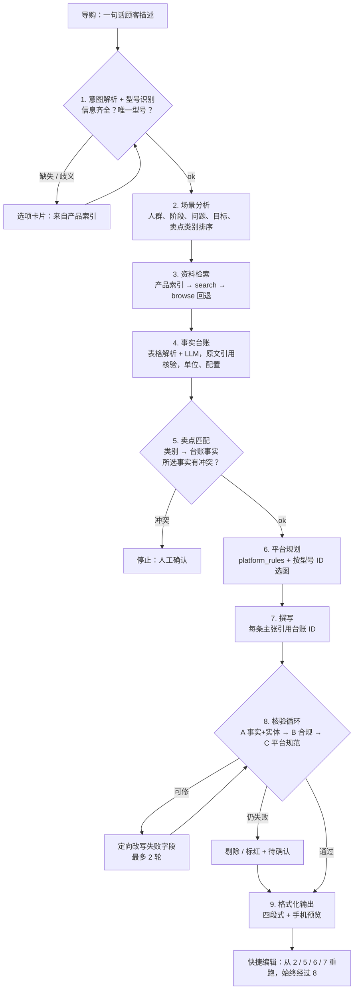

# 项目说明：华为 PC 图文软文 Agent

> 骨架版。各节由对应负责人在集成后补充细节与运行结果；不得粘贴知识库原文、引用、价格或图片。

## 1. 项目概述
- 解决的问题、面向的用户（门店导购）、闭环一句话。

## 2. 架构

- 模块与负责人对照（见 `docs/CONTRACTS.md` §2）。
- 数据对象（`agent/schemas.py`）。

## 3. ima 知识库的调用方式
- 统一脚本 `ima-skill/ima_api.cjs` 通过 subprocess 调用（`agent/ima_wrapper.py`）。
- 仅用四个接口：`search_knowledge_base`（启动时识别知识库）、`get_knowledge_list`（目录）、`search_knowledge`（检索）、`get_media_info`（原文 / 访问链接）。
- 空检索 → `get_knowledge_list` 浏览回退。
- 配额（220021）与磁盘缓存：约 25 次定向目录调用建索引、24 h 缓存、出错时沿用旧缓存并提示。
- 索引状态（complete / partial / stale）如何呈现。

## 4. 提示词设计
- 场景分析（只输出类别，不碰参数）。
- 卖点匹配（ID 必须存在）。
- 撰写（JSON 输出、每条主张引用 `[F#]`、平台规则、写作规则）。
- 定向改写（只改失败字段）。

## 5. 事实台账与原文核验
- 表格解析 + LLM 提取；`quote` 必须逐字存在于原文，`value` 必须在 `quote` 中。
- 单位归一（`config/units.yaml`）、配置变体与冲突的区分。
- 冲突处理：所选事实冲突 → 停止；未使用 → 排除 + 待确认。

## 6. 图片规则
- 三重匹配：文件夹属于该型号子树 AND 文件名 slug == model_id AND 出现在该型号 `图片索引.csv`。
- 不足不补、无图标待确认、海报无图则拒绝。
- 图片说明只来自知识库。

## 7. 核验（8A / 8B / 8C）
- 8A 数字与实体、相近型号串参、虚构类主张模式。
- 8B 禁用词、竞品、最 字改写（保留上限含义）。
- 8C 平台结构、篇幅、图片数、套话。
- 核验循环与失败后的处理。

## 8. 平台与场景适配
- 五个平台的结构 / 篇幅 / 图数 / CTA 差异。
- 八个场景的切入角度与卖点顺序差异。
- 快捷编辑表。

## 9. 部署
- ModelScope 创空间：Python + Node.js，密钥放在 Secrets。
- 公开演示保护：限流、无原文浏览、无批量导出、错误信息友好化。

## 10. 已知限制
- 待补充（配额、文本型产品、价格默认关闭、P4 目录不可读等）。

## 11. 运行结果
- 待补充：至少 3 组（2 个以上场景、2 个以上平台）的四段式输出、各阶段耗时、核验结论。只放我们的文章、资料标题与图片文件名。
