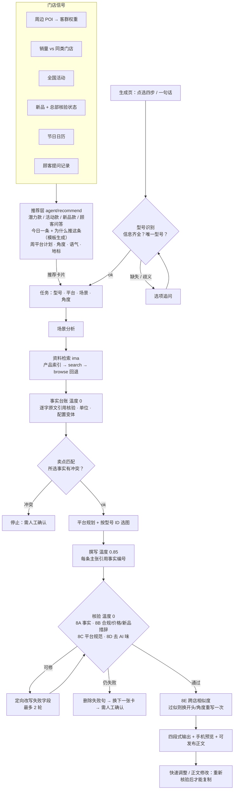

# 项目说明：华为 PC 门店图文软文 Agent

> 浙客松 AI+X 破界黑客松 · 华为赛道。本文是项目的说明书：解决什么问题、怎么做、做到了什么、还差什么。
> 本文不含知识库原文、引用、价格或图片；运行结果只引用 `samples/` 中自动导出的文案与核验摘要。

## 1. 项目概述

**用户**：华为 PC 线下门店的店员、店长，以及管理这些门店的总部运营。

**问题**：华为提出了三个痛点。

1. 门店被要求定期在朋友圈 / 小红书 / 公众号发帖，店员忙、不想多干活、写不好，发帖变成形式主义。
2. 现有系统生成的文案一股 AI 味，下发到上千家门店后千篇一律，没法用。
3. 大模型写新品时容易编参数、过度承诺；自建知识库或用 ima 都没能同时做到「吸引人 + 准确 + 不夸大」。

**做法**：把「店员说要写什么 → Agent 写」的拉取模式，改成**推送模式**：

> 店员早上打开应用，**今天这家店该发的那条已经写好了**。看一眼「为什么推这条」，点复制，发出去，点「标记为已发布」。目标是每天 30 秒以内。

- 发什么、发到哪：由**推荐层**决定。全国信号（活动、新品、节日）决定**推什么**，门店周边客群决定**怎么讲**。不推最畅销的，也不推卖不动的，推「在这里应该卖得好、实际卖得不够」的型号。
- 写得对：每条产品事实、每张图片都来自 ima 共享知识库「任德耀新建华为PC知识库」。事实在温度 0 下提取并锁定，撰写只改变表达。
- 写得不像 AI、不千店一面：门店语气与地标、去 AI 味检查、跨店相似度检查。
- 新品：**总部核验一次，所有门店据此生成**。未核验的新品锁定，不生成。
- 兜底：未通过核验的文案绝不交付，而是删句、换卡，最后转「需人工确认」。

## 2. 架构

**两条入口，一条流水线**：门店端的推荐卡片已经带着型号、平台、场景、角度、语气，直接进入流水线，跳过意图解析；「生成」页的手动输入先经过型号识别与追问。之后完全相同。

**推送模式的落地**：`scripts/prepare_today.py` 在早上为每家门店生成今日一条（朋友圈 + 小红书，本周公众号未达标时再加公众号），作为真实运行记录保存在 `runs/<日期>/prepared/`。店员打开门店端直接看到；「重新生成」「换一条」现场运行。

**系统组成**：

| 部分 | 位置 | 说明 |
|---|---|---|
| 前端 | `frontend/`（Vue 3 + Vite） | 门店端、生成、总部端、登录；工程师口令解锁的四店对比、对照组 |
| 服务 | `server.py`（FastAPI） | `/api/*`，慢操作以 NDJSON 流式返回进度；会话保存在服务端；按会话与全局限流；同时托管前端构建产物 |
| 界面逻辑 | `ui/` | 与框架无关：门店端会话规则（预生成优先、发布/修改闸门、导出）、总部端、对比、对照组 |
| 推荐 | `agent/recommend/` | POI 客群、销量潜力、活动、新品、日历、周平台计划、推荐理由 |
| 流水线 | `agent/pipeline.py` 及各阶段模块 | 见上图；模块与负责人对照见 `docs/CONTRACTS.md` §2，共享类型见 `agent/schemas.py` |
| 界面 ↔ 后端契约 | `docs/UI_BACKEND_CONTRACT.md` | 界面只调用其中列出的函数，由 `tests/test_ui_contract.py` 校验 |

## 3. ima 知识库的调用方式

- 统一使用官方脚本 `ima-skill/ima_api.cjs`（原样保留），由 `agent/ima_wrapper.py` 通过 subprocess 调用。
- **只读，仅用四个接口**：`search_knowledge_base`（启动时按名称找到共享知识库）、`get_knowledge_list`（目录）、`search_knowledge`（检索）、`get_media_info`（原文与访问链接）。不调用任何写入或上传接口。
- **产品索引**：只根据目录结构建立型号 ID → 规范名称、别名、同系列型号、参数文档、图片的映射，不遍历整个知识库。
- **检索**：先按产品索引定位该型号的文档，空结果时用 `get_knowledge_list` 浏览回退。
- **缓存与配额**：目录类调用在磁盘缓存 24 小时；出错时沿用旧缓存并提示；遇到日配额错误（220021）后本进程不再发起实时调用，也不尝试绕过。`get_media_info` 返回的是签名链接，从不缓存。
- **事实缓存**：每个型号的事实台账按产品缓存（`agent/fact_cache.py`），同一型号的多次生成与修改不重复提取，体现「核验一次，多次生成」。
- **本地镜像（可选）**：`KB_BACKEND=hybrid|local` 时从本机知识库镜像读取，减少 ima 调用；镜像不入库、不外传。
- 知识库 ID、Client ID、密钥只在程序内部使用，界面只显示「已配置」。

## 4. 提示词设计

提示词在 `prompts/`，原则是**让 LLM 只做它擅长且可被核验的部分**。

| 提示词 | 阶段 | 要点 |
|---|---|---|
| `intake.md` | 意图解析（仅生成页） | 只抽取型号名称、人群、场景、平台、配置与额外要求，没说的填空，不猜；型号再由产品索引解析，缺失或有歧义时用选项追问 |
| `scenario.md` | 场景分析 | 只输出人群、阶段、问题、目标与**卖点类别排序**，不碰任何参数 |
| `reconcile.md` | 卖点匹配 | 卖点类别 → 台账事实编号；编号必须存在；所选事实有冲突即停止 |
| `writer.md` + `system_prompt.md` | 撰写 | JSON 输出；每条产品主张引用 `[F#]`；遵守平台结构与写作规则；价格只能来自活动记录；不写店员姓名 |
| `rewrite.md` | 定向改写 | 只改失败的字段，并附上失败原因 |

推荐理由（「为什么推这条」）**不经过 LLM**，由模板填入计算值，因此不会编造。

## 5. 事实台账与原文核验

- **提取**：表格解析 + LLM（温度 0）。每条事实带 `quote`，`quote` 必须逐字存在于原文，`value` 必须出现在 `quote` 中，否则丢弃。
- **单位归一**：`agent/units.py` 统一 mm / kg / Wh / 英寸等写法；数字白名单见 `config/number_whitelist.yaml`。
- **配置变体与冲突**：区分「同一型号不同配置」（如不同键盘版本的重量）与真正的资料冲突。所选事实有冲突 → 停止，转人工；未被使用的冲突事实 → 排除并标为待确认。
- **双温度设计**：事实提取与全部核验为温度 0；只有撰写使用较高温度（`WRITER_TEMPERATURE=0.85`，Phase 5 在 12 家门店上评测后确定）。撰写只能引用事实编号，展示前去掉编号。
- **新品闸门**：新品先生成事实卡（草稿），总部在「总部端 → 新品上市审核」确认发布后，新品款才对所有门店解锁；草稿状态的新品卡锁定，不生成。

## 6. 图片规则

- **三重匹配**：图片所在文件夹属于该型号子树 **且** 文件名标识等于型号 ID **且** 出现在该型号的 `图片索引.csv` 中，才算该型号的图。杜绝相近型号串图。
- 图不够就少放，不拿别的型号补；没有图时标为待确认；海报无图则不生成。
- 图片说明只来自知识库；`config/image_denylist.yaml` 排除不适合发布的图。
- 页面中的图片以内嵌数据显示，不暴露媒体 ID 或访问链接；不提供批量图片导出，只能逐张保存或随发布包下载。

## 7. 核验（8A–8E）

| 核验 | 检查什么 | 实现 |
|---|---|---|
| **8A 事实与实体** | 文中每个数字、规格词都能对应台账事实；没有相近型号串参；没有无依据的事实性说法 | 代码比对 + LLM 层；只在 LLM 指明目标事实时自动补引用，带无依据数字的句子从不自动补 |
| **8B 合规** | 禁用的绝对化用语、竞品、店员姓名；**价格 / 优惠 / 补贴 / 库存只能来自当前活动记录且精确匹配**；「新品 / 首发 / 刚发布」等措辞只有在台账有对应发布事实时才允许 | `agent/checks/`，`config/banned_words.txt`、`competitors.txt`、`personal_names.txt`、`claim_patterns.yaml` |
| **8C 平台规范** | 结构、篇幅、图片数量、话题标签、emoji、行动引导；小红书禁止编造个人体验 | `agent/platform_rules.py` |
| **8D 去 AI 味** | 时代套话、空洞动词、模板句式、强行网络用语、销量用语；反问与排比数量；必须有一个具体细节 | `agent/style/antiai.py` |
| **8E 跨店相似度** | 同一天同类门店的文案字符 3-gram 相似度不超过阈值（默认 0.55） | `agent/style/similarity.py`；超阈值则换未用过的开头、必要时换角度，重写一次 |

**核验循环**：8A / 8B / 8D 并行，8C 随后；失败字段定向改写，最多 2 轮。仍失败 → 删除失败句再核验 → 换门店的下一张卡 → 「需人工确认」。**未经核验通过的文案永远不会出现在可复制区域**；店员手动修改正文后，必须「检查并保存」重新通过核验才能复制或导出。

## 8. 平台与场景适配

| 平台 | 结构 | 正文字数 | 图片 | 其他 |
|---|---|---|---|---|
| 公众号 | 标题 + 导语 + 分段正文 + 结尾引导 | 800–1500 | 2–4 | 无 emoji、无话题标签 |
| 小红书 | 口语化标题 + 短段落 + 场景 + 话题标签 | 300–600 | 3–6 | 3–8 个话题；禁止编造个人体验 |
| 朋友圈 | 一个核心卖点 + 到店或咨询引导 | 50–150 | 1–3 | 只讲一个卖点；emoji ≤ 2 |
| 海报 | 主标题（≤10 字）+ 副标题 + ≤3 个卖点 + 到店引导 | 20–80 | 1 | 无图不生成 |
| 抖音图文 | 钩子首句 + 2–3 短段 + 话题 | 100–300 | 3–9 | 每张图说明 ≤12 字（我们的扩展） |

**场景**（`config/scenarios.yaml`）：开学季、职场办公、内容创作、家庭换新、企业采购、门店到店、新品首发、节日营销、校园日常。每个场景规定切入角度、卖点顺序和禁用说法。

**门店差异化**：

- **客群角度**：校园店 → 上课携带、全天续航、宿舍/图书馆；写字楼店 → 会议差旅、多任务、数据安全；社区店 → 上手简单、全家共用、资料迁移；商圈店 → 送礼怎么选、到店体验。
- **语气与地标**：每家店有默认语气（亲切店长 / 懂技术的店员 / 学长学姐风）和「XX 附近」地标，门店可改。
- **开头与角度轮换**：同类门店在同一天分到不同的开头方式与角度。

**周平台计划**：周一到周日为 公众号 · 小红书 · 朋友圈 · 小红书 · 朋友圈 · 小红书 · 朋友圈；每周最低 朋友圈 3、小红书 3、公众号 1。公众号由店长发布。门店端显示本周进度。

**快速调整**：

| 调整 | 从哪一步重跑 |
|---|---|
| 短一点 | 撰写 → 核验 |
| 换卖点、换个角度 | 卖点匹配（复用台账）→ 平台规划 → 撰写 → 核验 |
| 换平台 | 平台规划（复用台账与策略）→ 撰写 → 核验 |
| 加上立减500（演示用） | 8B 在撰写前直接拦截：活动记录里没有的价格不能写 |

## 9. 部署与运行

- 运行环境：Python 3.10+ 与 Node.js 18+（前端构建与 ima 脚本都需要）。
- 单进程：`python server.py` 同时提供接口与前端（默认端口 7861，`PORT` 可改）。启动与配置步骤见 `README.md`。
- 密钥只放环境变量（本地 `.env`，线上放平台的 Secrets）。
- 公开演示保护：按会话最小间隔与每小时次数、全局每小时上限（`RATE_*` 环境变量可调）；不提供知识库原文浏览或批量导出；错误以通俗中文显示，不暴露堆栈、密钥或 ID。
- 「四店对比」「对照组」是给工程师演示用的页面，用 `ENGINEER_PASSCODE` 隐藏；这只是隐藏入口，不是访问控制。

## 10. 已知限制

- **门店数据是合成的**：门店、销量、活动与演示活动价、顾客提问、发布记录均为模拟数据（主办方已同意），界面上逐条标注；周边 POI 使用生成的样例数据，未接入真实高德数据（`scripts/fetch_poi.py` 已就绪，需 `AMAP_KEY`）。
- **不能自动发帖**：朋友圈和个人小红书没有开放发帖接口；「标记为已发布」由店员手动点击。
- **生成速度**：现场生成一条约 1 分钟，慢时数分钟，所以采用早上预生成。
- **通过率**：评测中 12 家门店有 9 家在 2 轮改写内通过（Phase 5，朋友圈）；其余由兜底流程处理，不会交付未通过的文案。
- **会话与核验状态在内存中**：重启服务会清空会话、已发布标记与总部的新品核验状态；预生成的文案保存在磁盘，不受影响。
- **周平台计划与配额**是我们的假设，华为真实的发帖要求可在 `data/demo/inputs/platform_quota.json` 中配置。
- **发布效果**（阅读、点赞、咨询）未接入真实数据，是后续工作。
- 价格默认不写；只有当前活动记录里的价格可以出现，并带「演示活动」标注。

## 11. 运行结果

**演示日 2026-10-23 预生成**（`scripts/prepare_today.py --demo`，真实 ima + LLM，写作温度 0.85）：

| 指标 | 结果 |
|---|---|
| 生成的文案 | 46 条，覆盖 12 家门店（请求的版本：朋友圈 30 · 小红书 12 · 公众号 4） |
| 核验全部通过并交付 | 45 条 |
| 交付文案的实际平台 | 朋友圈 35 · 小红书 8 · 公众号 2（差异原因见下） |
| 转「需人工确认」 | 1 条（未交付） |
| 改写轮数 | 0 轮 18 条 · 1 轮 16 条 · 2 轮 11 条 |
| 单条耗时 | 中位数约 74 秒（最快 23 秒，最慢 279 秒） |

**请求与实际平台不一致的 5 条**（S01、S03、S04、S11 的小红书，S08 的公众号）：这些版本两轮改写后仍未通过，兜底「换下一张卡」时沿用了下一张卡默认的朋友圈，交付的是一条通过核验的朋友圈文案。这是兜底逻辑的缺陷，已修复（换卡时保持原平台，`tests/test_fallback.py` 覆盖）；这 5 条需重新运行 `prepare_today` 才会变成对应平台的文案。

**代表性样例**（全文见 [`samples/`](../samples/README.md)，由 `scripts/export_samples.py` 自动导出、未经手工编辑）：

| 样例 | 门店 / 场景 | 展示什么 |
|---|---|---|
| `S01-potential-moments.md` | 校园店 · 潜力款 · 朋友圈 | 学生客群 → 宿舍/图书馆角度；推荐理由（模拟数据已标注）；核验 8A–8D 通过 |
| `S02-promo-moments.md` | 校园店 · 活动款 · 朋友圈 | 与 S01 同为校园店，文案相似度 0.119（阈值 0.55） |
| `S04-potential-moments.md` | 写字楼店 · 潜力款 · 朋友圈 | 上班族客群的角度 |
| `S08-potential-moments.md` | 社区店 · 潜力款 · 朋友圈 | 家庭客群的角度 |
| `S10-promo-moments.md` | 商圈店 · 活动款 · 朋友圈 | 与 S01 同型号，换成送礼/到店体验角度 |
| `S08-potential-xiaohongshu.md` | 社区店 · 潜力款 · 小红书 | 与 S08 朋友圈样例同一张推荐卡，按小红书规范重写：口语化标题、短段落、话题标签 |
| `S12-promo-wechat_article.md` | 商圈店 · 活动款 · 公众号 | 公众号长文：标题 + 导语 + 分段正文 + 结尾引导 |
| `S01-new_release-locked.md` | 新品款 | 资料未经总部确认时锁定，不生成 |
| `S03-needs-review.md` | 兜底 | 两轮改写、删句、换卡后仍未通过 → 需人工确认 |

每个样例都附「四、核验结果」：事实编号 → 字段 → 文中取值，来源统一标为「知识库产品参数」。样例覆盖朋友圈、小红书、公众号三个平台，校园 / 写字楼 / 社区 / 商圈四类门店。
